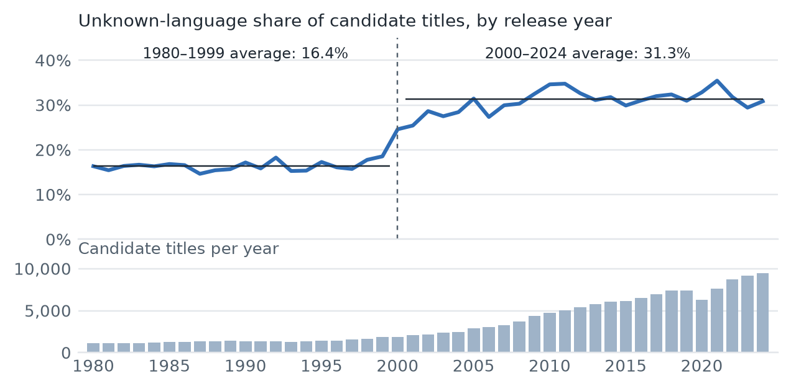

# Data

*Team Synaptech · "Do Collaborator Moves Predict Cross-Language Career Entry?" · Data Lead's section. Every number below was recomputed from the project files (code at commit `eab6f5e`). Open items are marked* **[TO CONFIRM: …]**.

## 1. Sources and licensing

We combine four public sources. **IMDb** provides the credits: the non-commercial datasets `title.basics`, `title.principals` and `title.akas`, downloaded on 22 October 2026 (file timestamps) **[TO CONFIRM: IMDb snapshot date]**, used under IMDb's non-commercial licence for coursework only. We do not redistribute them: the repository ignores its data directory, and the samples we share contain only identifiers, years, billing order and labels. **[TO CONFIRM: exact IMDb attribution wording required for the submission.]** **TMDB** supplies each title's original language through the IMDb-ID `/find` endpoint and, for one rule, its `spoken_languages` field. *This product uses the TMDB API but is not endorsed or certified by TMDB.* **Wikidata** (original language, property P364, matched through the IMDb-ID property P345) is our second labelling tier and feeds two rules. **English Wikipedia** (the film-infobox language of the article that links to the IMDb title) is used only for targeted validation and rule (a2) **[TO CONFIRM: attribution wording for Wikidata (CC0) and Wikipedia (CC BY-SA)]**. We queried the three APIs at a rate-limited pace with caching and did not scrape IMDb pages.

## 2. Scope and filtering

We study feature films and TV movies (`movie`, `tvMovie`) released 1980–2024, using actor and actress credits billed in the top 10, and five focal languages: Hindi (hi), Tamil (ta), Telugu (te), Malayalam (ml) and Kannada (kn). The team fixed 2024 as the end year. A title is a *candidate* if `title.akas` holds an alternate title in region `IN` or in a focal language. This keeps the language lookups to 157,740 titles instead of all 399,097 in the period. Table 1 shows what survives each filter; titles outside the candidate rule are never sent to TMDB.

**Table 1.** Funnel from the IMDb files to the credit table (version `final_v2`).
{: .caption }

| Step | Titles | Credits | Note |
| :--- | ---: | ---: | :--- |
| IMDb title records; principal-cast rows | 12,881,968 | 102,420,102 | all types, all years |
| Actor or actress credits | — | 42,496,106 |  |
| Billed in the top 10 | — | 41,475,450 |  |
| Feature films and TV movies | 916,725 | — | `movie`, `tvMovie` |
| …with a start year | 798,693 | — |  |
| …released 1980 or later, with ≥1 top-10 actor credit | 429,549 | 3,158,416 | 3,207,781 rows before dropping 49,365 repeated title–actor pairs |
| Released 1980–2024 | 399,097 | 2,940,846 | 30,452 titles after 2024 dropped |
| **Indian candidate titles** (`IN`-region or focal-language aka) | **157,740** | **1,243,786** | 241,357 titles never sent to TMDB |
| …labelled with a focal language | 18,532 | 155,677 | used for language events |
| …labelled with another language | 93,521 | 801,810 | kept with label; never a source or destination |
| …ties only (no language) | 45,687 | 286,299 | 45,418 unknown + 269 rule-flagged titles |

## 3. Language assignment and the fallback strategy

Our unit of language is a title's *original* language, assigned in tiers. **T1** takes `original_language` from the TMDB record found by IMDb ID, preferring a movie match over a TV match. **T2** applies only to titles TMDB did not resolve: it takes Wikidata's original language for the item with the same IMDb ID. Titles resolved by neither tier are **unknown**. We never infer language from the cast. Of the 157,740 candidate titles, T1 resolves 108,447 (68.8%), T2 adds 3,873 (2.5%), and 45,420 (28.8%) remain unknown (all years including 2025 onward: 174,014 candidates; T1 118,852, T2 3,941, unknown 51,221). Table 2 gives the match rates by decade and by language.

**Table 2.** Share of candidate titles resolved by each tier, by release decade and (for resolved titles) by original language.
{: .caption }

| Group | Titles | T1 TMDB | T2 Wikidata | Unknown |
| :--- | ---: | ---: | ---: | ---: |
| 1980s | 12,342 | 76.3% | 7.7% | 16.0% |
| 1990s | 14,533 | 77.6% | 5.6% | 16.8% |
| 2000s | 28,312 | 67.9% | 2.9% | 29.1% |
| 2010s | 61,410 | 66.3% | 1.7% | 32.0% |
| 2020–24 | 41,143 | 67.5% | 0.6% | 31.9% |
| **All, 1980–2024** | **157,740** | **68.8%** | **2.5%** | **28.8%** |
| *By original language (resolved titles only):* |  |  |  |  |
| Hindi (`hi`) | 5,697 | 93.8% | 6.2% | — |
| Tamil (`ta`) | 4,109 | 83.2% | 16.8% | — |
| Malayalam (`ml`) | 3,933 | 83.5% | 16.5% | — |
| Telugu (`te`) | 3,045 | 84.3% | 15.7% | — |
| Kannada (`kn`) | 2,016 | 75.1% | 24.9% | — |

**Table 2b.** Share of titles resolved by T1 / T2 (% of the group's titles), by original language and release decade, in `final_v2`.
{: .caption }

| Decade | Hindi | Tamil | Telugu | Malayalam | Kannada | Other |
| :--- | ---: | ---: | ---: | ---: | ---: | ---: |
| 1980s | 91.6 / 7.8 | 76.1 / 22.0 | 60.0 / 39.2 | 61.8 / 37.8 | 71.9 / 26.6 | 98.0 / 2.0 |
| 1990s | 90.6 / 8.8 | 66.6 / 32.8 | 74.9 / 23.9 | 77.7 / 22.0 | 67.2 / 31.7 | 98.2 / 1.8 |
| 2000s | 92.8 / 6.0 | 73.7 / 24.1 | 82.1 / 16.9 | 83.1 / 16.6 | 71.9 / 27.6 | 98.3 / 1.7 |
| 2010s | 91.5 / 6.3 | 87.5 / 9.1 | 88.0 / 10.1 | 93.6 / 4.8 | 69.6 / 28.8 | 98.7 / 1.3 |
| 2020–24 | 96.8 / 1.9 | 95.1 / 3.4 | 95.4 / 1.9 | 96.7 / 1.9 | 92.0 / 7.1 | 99.4 / 0.6 |
| **All decades** | **92.5 / 6.2** | **81.1 / 16.8** | **82.6 / 15.7** | **82.6 / 16.5** | **74.0 / 24.9** | **98.7 / 1.3** |
| *Titles (n)* | *5,697* | *4,109* | *3,046* | *3,933* | *2,016* | *93,521* |

Each cell is T1 / T2. The group is every title with that language, so the cell does not sum to 100%: the remainder is the rule-flagged titles (Section 5) and the 2 titles filled by hand (Telugu and Gujarati), which `final_v2` records as separate tiers. The 269 flagged titles stay in their language group by the label they had before the rule fired. On Table 2's basis, with the flagged titles counted as T1, the all-decades row would reproduce its language shares exactly (for example Hindi 93.8% / 6.2%, against 92.5% / 6.2% here); Telugu and Other each hold one more title here (3,046 and 93,521) because Table 2 counted the two hand-filled titles as unknown. Unknown titles have no language, so they cannot appear in this table: they are split only by akas evidence (Table 2c). The full long-format table (every year 1980–2024, every tier, with its denominator) is `results/match_rates_final_v2.csv`.

**Table 2c.** Share of titles still unknown, by the `title.akas` evidence that made the title a candidate and by release decade.
{: .caption }

| Decade | `IN`-region evidence only: titles | Unknown | Focal-language alternate title: titles | Unknown |
| :--- | ---: | ---: | ---: | ---: |
| 1980s | 11,049 | 17.2% | 1,293 | 5.8% |
| 1990s | 12,729 | 18.4% | 1,804 | 5.3% |
| 2000s | 25,159 | 32.4% | 3,153 | 3.1% |
| 2010s | 54,182 | 35.8% | 7,228 | 3.2% |
| 2020–24 | 32,566 | 37.6% | 8,577 | 10.3% |
| **All, 1980–2024** | **135,685** | **32.5%** | **22,055** | **6.3%** |

The akas language is evidence, not the film's language: an alternate title in a language says that a release exists under that title, not that the film was made in it, and we never use it to set a label. The two groups partition the 157,740 candidates (135,685 + 22,055). Unknown is 45,418 titles here, 45,420 on Table 2's basis before the two hand corrections.

**Why unknown titles stay in the graph.** A strict inner join on resolved titles would delete every edge contributed by the 45,420 unresolved titles, and with them the collaborations between actors whose only shared film is unresolved. Feedback on our proposal warned that this would fragment the collaboration network. We therefore use a left join: unresolved titles stay in the credit table with no language, so they supply ties but never a language event and never a source-language credit.

**What `title.akas` can and cannot do.** It cannot give the original language: among the 429,302 titles with alternate titles, the original-title row carries neither a language nor a region in any case. We use it only to shortlist candidates and to flag possible dubs for review. The unknown share depends on this evidence: it is 32.5% of the 135,685 candidates whose only Indian evidence is an `IN`-region title, against 6.3% of the 22,055 with a focal-language alternate title.

## 4. Candidate-set recall check

To test whether the candidate rule misses focal-language films, we drew 2,000 random titles from outside it and looked each up on TMDB. 1 of them (0.05%; 95% Wilson interval 0.01–0.28%) had a focal-language original language. As far as TMDB can tell, the rule captures almost all focal-language titles; it cannot detect titles that TMDB itself lacks or mislabels.

## 5. Dubbed and ambiguous titles

Dubbed releases never count as new-language credits, because a title's language is always its original language: a Hindi dub of a Telugu film is a Telugu title, and its actors gain no Hindi credit. A dubbed IMDb entry that carries the dub's language would break this, so we looked for them: the pre-fill described below found 0 dubbed entries in the control sample, and the cross-check agreed on all 29 of its rows. Genuinely multilingual productions cannot be given one original language. We therefore take a title out of language events (it stays in the graph as a tie) when any of three predefined rules fires, applied to the 18,800 focal-labelled titles:

* **(a2)** TMDB `spoken_languages` *and* the IMDb-matched Wikipedia infobox both list two or more focal languages;
* **(b-focal)** Wikidata lists two or more focal languages as original languages;
* **(c)** TMDB's original language is not among Wikidata's original languages (both available).

**Table 4.** Titles and credits flagged by each rule, and the change in eligible actor–language pairs and first-entry events (differences from the no-rule baseline in parentheses). Rule (a) is the first, TMDB-only version of (a2); see Section 7.
{: .caption }

| Rule set | Titles flagged | Credits flagged | Eligible actor–language pairs | Events (all 20 pairs) | Smallest pair (events) |
| :--- | ---: | ---: | ---: | ---: | ---: |
| No rule (baseline) | 0 | 0 | 3,998 | 1,606 | 24 |
| (a) TMDB spoken languages only | 448 | 3,975 | 3,932 (−66) | 1,462 (−144) | 19 |
| (a2) TMDB and Wikipedia | 83 | 740 | 3,991 (−7) | 1,553 (−53) | 22 |
| (b-focal) Wikidata | 125 | 1,117 | 3,986 (−12) | 1,549 (−57) | 24 |
| (c) TMDB–Wikidata disagreement | 108 | 900 | 3,989 (−9) | 1,560 (−46) | 24 |
| (a) + (b-focal) + (c) — `final` | 622 | 5,484 | 3,911 (−87) | 1,396 (−210) | 19 |
| **(a2) + (b-focal) + (c) — `final_v2` (primary)** | 269 | 2,342 | 3,970 (−28) | 1,488 (−118) | 22 |

The primary set flags 269 titles (1.4% of focal-labelled titles) yet removes 7.3% of events (1,606 to 1,488), because bilingual films are where a first credit in a second language tends to arise; eligible pairs fall from 3,998 to 3,970. We also tested plain Wikidata (two or more original languages of any kind), which flags 235 titles, and replaced it with (b-focal) because it counts non-focal languages as second languages.

## 6. Validation and its limits

We describe exactly what was done. **(i) AI-assisted pre-fill.** We built a review list of 5,672 titles with warning signs (label absent from the title's alternate-title languages: 3,792; unknown with focal-language alternate titles: 1,385; alternate titles in several languages: 938; Wikidata with several languages: 33; a title can have several reasons), ranked by the ties it carries. A language model pre-filled rows using only TMDB and Wikipedia evidence (articles matched by IMDb link), kept the current label unless the evidence was clear, and flagged ambiguity only for a source conflict or a source listing several languages. For T1 titles TMDB is the source of the label, so its agreement is not independent; confidence is "high" only when an IMDb-matched Wikipedia article also agrees. **(ii) Blinded cross-check.** A second language model, shown only title, year and IMDb link, answered 29 rows: the 2 with a corrected language, all 7 flagged ambiguous, and 20 random high-confidence unflagged rows (from 122). **(iii) Human adjudication.** A team member checked all six disagreements against Wikipedia and TMDB (Table 6).

**Table 5.** Validation checks and results (confidence is high/medium/low).
{: .caption }

| Check | Sample | Result |
| :--- | :--- | :--- |
| Pilot pre-fill | first 30 rows of one reviewer's file | confidence high/medium/low 15/7/8; no evidence 7; ambiguous 1; label changes 0 |
| Control pre-fill | 200 random titles from the review list | evidence for 157, none for 43 (42 of them unlabelled); labels changed **0/157 (95% CI 0.0–2.4%)**; 2 unknown labels filled; 7 flagged ambiguous; 0 dubbed; confidence 122/28/50 |
| Blinded cross-check by a second language model | 29 rows: 2 corrected, 7 ambiguous, 20 random high-confidence | language agreement **26/29 = 89.7% (95% CI 73.6–96.4%)**; bilingual vs ambiguous 25/29 (86.2%); dubbed 29/29 |
| Human adjudication | the 6 cross-check disagreements | see Table 6 |

**Table 6.** Human adjudication of the six cross-check disagreements (three on language, four on the bilingual flag; Asvins differs on both).
{: .caption }

| Film (year) | Disagreement | Adjudicated finding | Consequence in the data |
| :--- | :--- | :--- | :--- |
| Lion (2015) | language: cross-check `en`, label `te` | Telugu original; the cross-check had looked up the 2016 film of the same name | Label correct (`te`); no change |
| Asvins (2023) | language: cross-check `ta`, label `te` | Tamil original (Wikipedia); **TMDB label wrong** | Label wrong in `baseline`; removed from language events by rule (c) in `final` and `final_v2` |
| Baladoor (2008) | bilingual: cross-check no, pre-fill yes | Telugu original, single-language; dubbed versions exist | Rule (a) false positive; kept as `te` in `final_v2` |
| Khiladi (2022) | bilingual: cross-check no, pre-fill yes | Telugu original, single-language; dubbed versions exist | Rule (a) false positive; kept as `te` in `final_v2` |
| Maanaadu (2021) | bilingual: cross-check no, pre-fill yes | Tamil original, single-language; dubbed versions exist | Rule (a) false positive; kept as `ta` in `final_v2` |
| Rakta Charitra (2010) | language: cross-check `te`, label `hi` | Hindi and Telugu (bilingual) | Correctly flagged; tie only in `final` and `final_v2` |

Adjudication found one probable source error: for Asvins, TMDB says Telugu and Wikipedia says Tamil. Counting it, the number of existing labels wrong in the control sample is **1 of 157 (0.6%; 95% CI 0.1–3.5%)**, which is a lower bound, because only 29 of the 200 control rows were human-checked. The control sample is drawn from the review list, whose titles have warning signs, and from the 4,072 titles below its 1,500 highest-impact entries; it therefore describes that higher-risk subset, not all 157,740 candidates, and is not a population error rate. The cross-check is itself fallible (it looked up the wrong film for one title) and shares TMDB and Wikipedia as sources with the pre-fill.

## 7. Disclosure: refinement of rule (a)

Rule (a) was first defined using only TMDB `spoken_languages` (two or more focal languages). Human adjudication showed that it over-flagged original, single-language films that merely have dubbed versions (Baladoor, Khiladi and Maanaadu). We refined it to (a2) *after seeing this*, so (a2)'s performance on those rows is in-sample. The change was made before we fitted any model.

## 8. Unlabelled titles and bias

Unknown titles are 28.8% of candidates overall, but the share rises from 16.4% in 1980–1999 (26,875 titles) to 31.3% in 2000–2024 (130,865 titles), with the step around 2000 (Figure 1). We have not tested why. A plausible explanation, which we have not verified, is that the growing number of small recent releases is sparsely covered by TMDB and Wikidata. This implies that focal-language actors may be missing some credits (recent years most), which makes source-language counts conservative, and that recent years are less labelled than early ones.

**Figure 1.** Share of candidate titles with unknown language by release year (top) and number of candidate titles per year (bottom); dashed line at 2000.
{: .caption }

In the primary analysis unknown credits are excluded from the 70% denominator (Section 9). Counting them instead would cut eligible actor–language pairs from 3,970 to 3,291: 679 pairs (17.1%) lose eligibility, 676 actors lose every source language, and 222 further pairs qualify later (median delay 3 years). We report both as a sensitivity analysis.

## 9. The final datasets

**Eligibility.** An actor–language pair enters the risk set in the first year the actor has at least 5 source-language credits across at least 3 distinct calendar years (not a span, and not necessarily consecutive), with source-language credits at least 70% of all prior labelled credits, and no prior destination-language credit. Credits in other resolved languages count in the denominator; unknown and rule-flagged credits do not. Table 7 lists the named versions: `final_v2` is the primary analysis table, `baseline` (no rules) is for sensitivity, and `final` is the first rule set. The three full versions have identical credits (1,243,786), titles (157,740) and actors (572,755) and differ only in the language label of flagged titles.

**Table 7.** Data versions (`data/processed/data_versions.csv`); rules a, a2, b-focal and c are defined in Section 5; the last column is the start of each file's SHA-256.
{: .caption }

| Version | File | Rules | Credits | Focal credits | Ties-only credits | SHA-256 (10) |
| :--- | :--- | :--- | ---: | ---: | ---: | :--- |
| `pre_review` | <code class="nw">credits_pre_review.parquet</code> | none | 1,243,786 | 158,012 | 283,974 | <code class="nw">f36308c6cb</code> |
| `baseline` | <code class="nw">credits.parquet</code> | none | 1,243,786 | 158,019 | 283,957 | <code class="nw">81a28e44e4</code> |
| `final` | <code class="nw">credits_final.parquet</code> | a + b-focal + c | 1,243,786 | 152,535 | 289,441 | <code class="nw">e6bf29249f</code> |
| `final_v2` | <code class="nw">credits_final_v2.parquet</code> | a2 + b-focal + c | 1,243,786 | 155,677 | 286,299 | <code class="nw">5d213b30fd</code> |
| `sample_final_v2` | <code class="nw">credits_final_v2_sample.parquet</code> | a2 + b-focal + c | 5,844 | 4,997 | 509 | <code class="nw">03c2bd0307</code> |
| `sample_final` | <code class="nw">credits_final_sample.parquet</code> | a + b-focal + c | 5,462 | 4,019 | 1,110 | <code class="nw">2d60528212</code> |
| `sample_baseline` | <code class="nw">credits_sample.parquet</code> | none | 5,518 | 4,469 | 624 | <code class="nw">6e8ca73580</code> |

Under `final_v2` there are 3,970 eligible actor–language pairs (3,966 actors) and 1,488 first-entry events across the 20 ordered pairs, between 22 and 165 per pair (Table 8). Every pair has at least 5,284 at-risk actor-years and passes the screen's descriptive thresholds (10 events, 100 at-risk actor-years). We have not yet chosen pairs for modelling.

**Table 8.** Pair screen for `final_v2`: first-entry events, eligible actors and at-risk actor-years per source→destination pair.
{: .caption }

| Pair | Events | Eligible actors | At-risk actor-years | Pair | Events | Eligible actors | At-risk actor-years |
| :--- | ---: | ---: | ---: | :--- | ---: | ---: | ---: |
| ml→ta | 165 | 735 | 10,688 | te→kn | 65 | 499 | 6,884 |
| hi→ta | 124 | 1,315 | 24,605 | kn→ta | 64 | 448 | 7,752 |
| ta→ml | 122 | 643 | 8,574 | ml→hi | 59 | 840 | 14,348 |
| hi→te | 114 | 1,305 | 24,659 | kn→te | 53 | 457 | 8,561 |
| ta→te | 110 | 624 | 8,780 | te→hi | 50 | 490 | 6,964 |
| hi→kn | 90 | 1,345 | 25,054 | ml→kn | 39 | 834 | 14,230 |
| hi→ml | 89 | 1,348 | 25,308 | ta→hi | 39 | 709 | 11,165 |
| te→ta | 83 | 440 | 5,284 | te→ml | 29 | 510 | 7,440 |
| ml→te | 78 | 814 | 13,648 | kn→hi | 25 | 466 | 8,799 |
| ta→kn | 68 | 687 | 10,187 | kn→ml | 22 | 469 | 8,938 |

## 10. Network connectivity

Table 9 compares connectivity of the focal-language actors with unknown and rule-flagged (ties-only) titles kept in the graph and dropped. Keeping them leaves slightly more actors in the largest component and fewer fragments. Over all 572,755 actors in the table, the largest component holds 87.0% (15,863 components).

**Table 9.** Connected components among actors with a focal-language credit (actors linked by a shared title).
{: .caption }

| Version | Focal-language actors | Components, ties kept | Largest component | Components, ties dropped | Largest component |
| :--- | ---: | ---: | ---: | ---: | ---: |
| `final_v2` (primary) | 32,739 | 220 | 96.9% | 280 | 95.8% |
| `baseline` (no rules) | 33,143 | 222 | 97.0% | 279 | 95.9% |

## 11. Limitations

* **Unknown titles** are 28.8% of candidates and unevenly spread over time (Section 8); dropping them from eligibility counts may lose real focal-language credits.
* **TMDB errors** exist: we found one (Asvins). Rule (c) removes it from language events in `final` and `final_v2`, but it is still labelled Telugu in `baseline`.
* **Titles without a Wikipedia article** cannot be flagged by (a2): 61 of the 448 titles flagged by rule (a) had no IMDb-linked article (the other 387 had one, and 83 of those are flagged by (a2)).
* **Validation is partial:** 29 of 200 control rows were human-checked; the pre-fill and cross-check share their sources; (a2) was refined in-sample.
* **Merged or missing IDs:** 325 title IDs in `title.principals` (1,446 credit rows) do not appear in `title.basics` and cannot be remapped, since IMDb ships no redirect table. The 14 T1 titles that share a TMDB ID are 7 collisions between a TMDB movie and a TMDB TV record (the two use separate ID spaces), not merged IMDb titles.
* **Parsing:** with pandas' default quote handling our reader parsed 102,420,102 of the 102,420,111 `title.principals` data lines (9 merged) and 59,809,790 of the 59,861,136 `title.akas` lines (51,346 merged, 0.09%); `title.basics` was complete. We re-ran the filters with quote handling disabled, in which every line parses. The credit-table figures are unchanged (only actor/actress rows move by one, 42,496,106 to 42,496,107), but the candidate set would grow by 88 titles (174,014 to 174,102). Of these, 71 fall in 1981–2024 (570 credits, 0.05% of credits; 392 of the 570 actors are already present) and 17 are out of scope. We did not add them, so Tables 1 and 2 are unchanged; this is a small, measured limitation that we had not documented before.
* **Coverage:** IMDb does not include some regional films, and titles outside the candidate rule (never sent to TMDB) are absent from the source-share denominator.
* **Inference:** our results will be predictive association, not causal.

## 12. Reproducibility

Environment: Python 3.13.0, pandas 3.0.6. Table 10 lists the commands; Table 7 gives the output hashes. Input SHA-256 (first 16 characters): `title.basics.tsv.gz` `5f75a4fb37da0f30`; `title.principals.tsv.gz` `94b081c911ca7b57`; `title.akas.tsv` `fc0e7024fe17df79`.

**Table 10.** Commands used.
{: .caption }

| Step | Command |
| :--- | :--- |
| Filter titles/credits; akas candidates and evidence | `filtering.py` functions via a driver script [TO CONFIRM: wrap in a CLI command] |
| Language labels (T1, T2) | `cinema-mobility resolve-labels --rate 20` |
| Rule evidence (TMDB, Wikidata, Wikipedia) | `cinema-mobility rules-fetch --wikipedia` |
| Baseline and primary credits | `cinema-mobility apply-review --reviewed data/review/corrections_control.csv --credits data/processed/credits_final_v2.parquet --baseline data/processed/credits_pre_review.parquet --ambiguity-rules spoken_wiki,wikidata_focal,disagree` (omit the last flag and change `--credits` for `baseline`) |
| Rule sensitivity; pair screen | `cinema-mobility rules-report --stage full`; `cinema-mobility select-pairs` |
| Match rates by tier, year, decade, language, akas evidence (Tables 2b, 2c) | `python scripts/match_rates.py` (writes `results/match_rates_final_v2.csv`; refuses to overwrite) |
| Quality report; version table | `cinema-mobility quality-report --end-year 2024`; `cinema-mobility data-versions` |

**[TO CONFIRM: TA's answer on AI-assisted labelling and rule-based exclusion.]**
