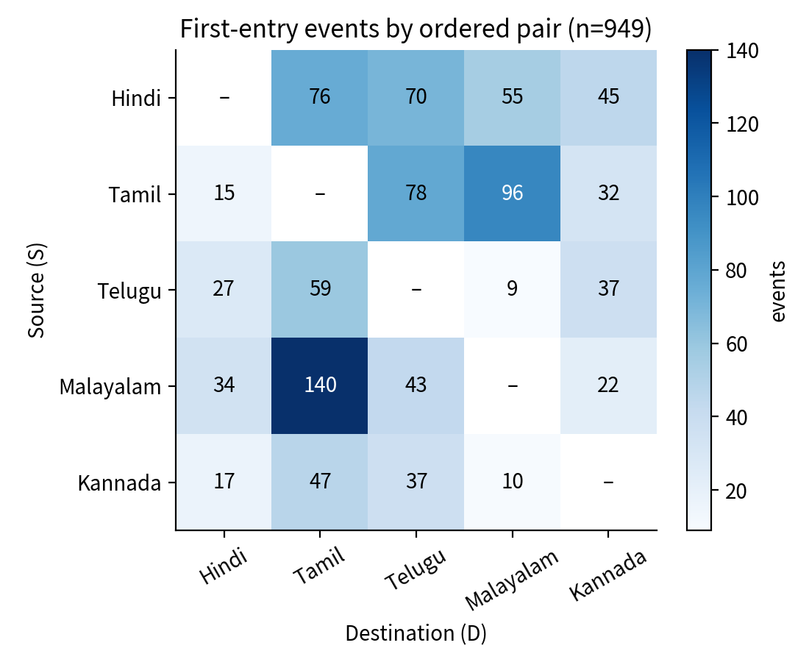
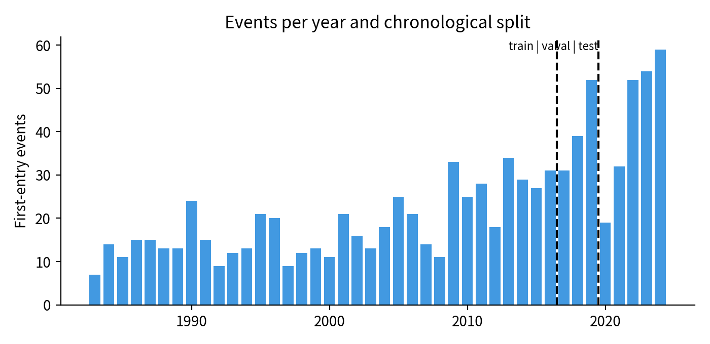
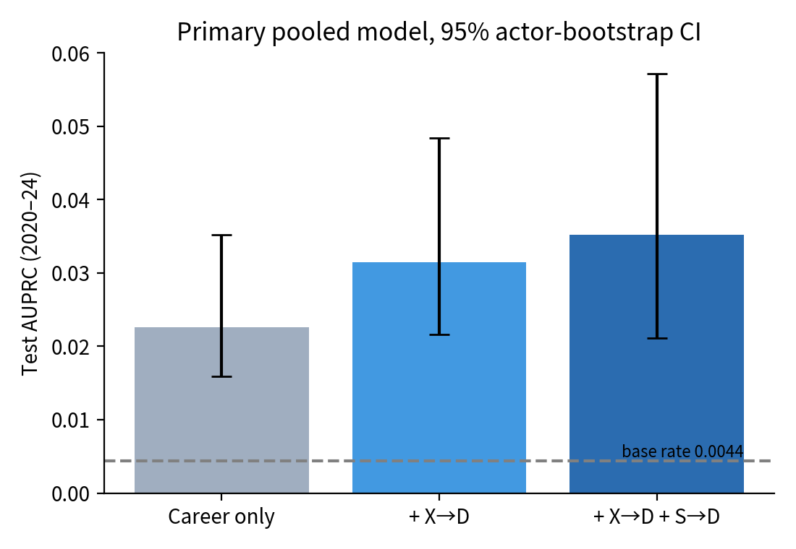
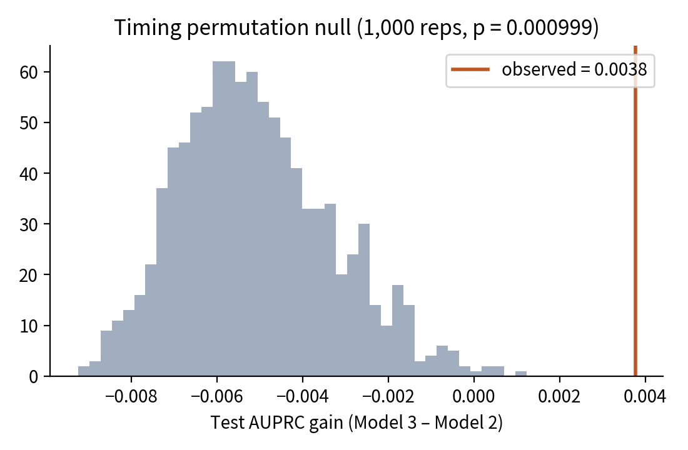
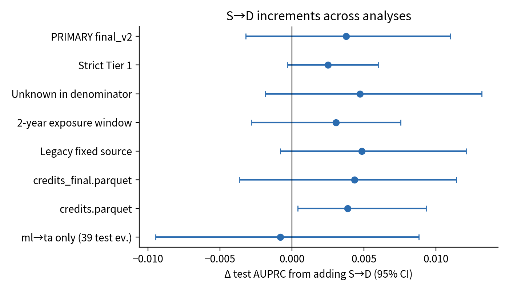
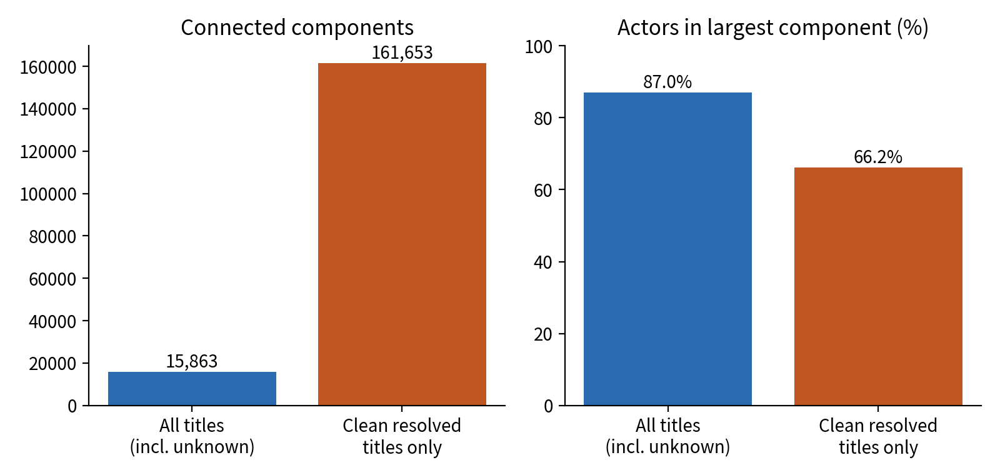
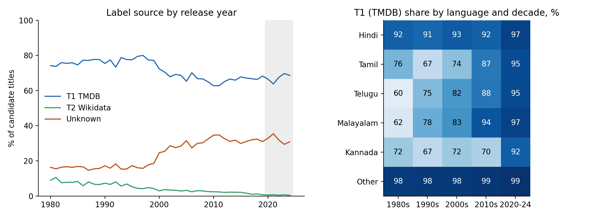

# Do Collaborator Moves Predict Cross-Language Career Entry?
## Temporal Network Signals in Indian Cinema

**Team:** Synaptech (ADA project)  
**Status:** Final. All figures and tables are computed from the saved model outputs; no model was re-fitted for this report.  
**Primary results:** `results/modeling/final_v2/`  
**Interpretation:** Predictive associations, not causal effects.

---

## 1. Executive summary

This study tests whether an actor's collaboration history contains predictive information about a first entry into a destination language in Indian cinema. It compares three discrete-time hazard models: (1) career history only, (2) career history plus exposure to collaborators who previously entered the destination language from a different source language (X→D), and (3) the second model plus direction-matched collaborator exposure (S→D).

The primary analysis uses the `credits_final_v2` dataset, the dynamic source-language definition, all 20 ordered source-to-destination language pairs, pair fixed effects, and actor-clustered inference. The actor-year panel contains 205,664 risk rows and 949 transition events. The chronological split is training through 2016, validation in 2017–2019, and test in 2020–2024; the test set contains 49,291 risk rows and 216 events.

On the held-out test set, AUPRC rises from 0.02261 for the career-only model to 0.03141 after adding X→D exposure, and to 0.03518 after adding S→D exposure. The X→D addition improves AUPRC by 0.00881; its actor-bootstrap interval is 0.00254 to 0.01793. The further S→D increment is 0.00377, but its interval (−0.00321 to 0.01100) includes zero, so the incremental held-out improvement is uncertain.

A separate timing-permutation diagnostic completed all 1,000 repetitions and returned a one-sided Monte Carlo p-value of 0.000999. This indicates that the observed timing-based AUPRC gain was unusual relative to the specified permutation null. It is a different diagnostic from the bootstrap interval and does not establish causality. These two findings should be reported together, not treated as contradictory.

Across sensitivity analyses, the addition of X→D generally improved test AUPRC, while the incremental S→D gain varied and its bootstrap interval included zero in most of the directly comparable pooled sensitivities. Results are consistent with useful predictive information in broad destination-language collaborator exposure, but provide less conclusive evidence that direction-matched exposure adds reliable out-of-time predictive performance beyond that baseline.

## 2. Research question and hypotheses

**Research question:** Does exposure to collaborators who previously made the same source-to-destination language transition add predictive information about an actor's first destination-language entry beyond general exposure to collaborators who entered that destination language?

- **H1:** Adding X→D exposure improves out-of-time prediction over the career-only model.
- **H2:** Adding S→D exposure improves out-of-time prediction over the model that already includes career history and X→D exposure.

The design is observational and predictive. It does not identify the causal effect of collaborators on an actor's career decisions.

## 3. Data and eligibility

The study uses film-credit records with language labels drawn from the documented upstream process, primarily TMDB and then Wikidata, with unresolved titles retained as unknown. The primary panel applies the dynamic source definition: the actor's source language is recalculated at each observation-year boundary from the latest unambiguous resolved language history. If the latest prior calendar year contains multiple clean languages, the source is treated as ambiguous rather than assigned an arbitrary order.

An actor is eligible for a source-to-destination risk observation when, based only on information before that observation year, the actor has at least five source-language credits across at least three distinct observed credit years, at least 70% of prior clean labelled credits are in the source language, and no prior destination-language credit. Unknown and rule-ambiguous credits are excluded from primary language-event evidence and the primary labelled-credit denominator. They can remain as collaboration ties in the network.

The main pooled panel includes all 20 ordered language pairs. Pair fixed effects account for systematic differences between pairs; uncertainty for model coefficients is calculated with standard errors clustered by actor. The split is chronological to test prediction on later years rather than randomly mixing future and past observations.

| Split | Years | Risk rows | Events |
|---|---|---:|---:|
| Train | Through 2016 | 131,661 | 611 |
| Validation | 2017–2019 | 24,712 | 122 |
| Test | 2020–2024 | 49,291 | 216 |
| **Total** | Study period represented in panel | **205,664** | **949** |

Exposure features use only co-appearance titles strictly after the collaborator's first clean entry into the destination language and strictly before the focal observation year; transition-year ties are excluded because within-year order is unobservable.

## 4. Model comparison and primary results

**Prediction models** are penalized logistic regressions (discrete-time hazards). For held-out evaluation, each model is refitted on the combined train + validation sample before scoring the test set. **Coefficient inference** uses a separate unpenalized GLM on the full risk set with actor-clustered standard errors; those coefficients are not the source of the reported test AUPRC values.

All three models use the same chronological split. AUPRC is emphasized because language-entry events are rare; ROC-AUC and Brier score provide complementary discrimination and probability-error summaries. Test-set bootstrap intervals resample actors and retain all test rows for each sampled actor; predictions are held fixed during resampling, so intervals represent test-metric uncertainty conditional on the fitted models.

| Model | Test AUPRC | Test ROC-AUC | Test Brier score |
|---|---:|---:|---:|
| Career history only | 0.02261 | 0.80052 | 0.004328 |
| Career + X→D | 0.03141 | 0.80989 | 0.004314 |
| Career + X→D + S→D | 0.03518 | 0.81229 | 0.004311 |

### Incremental AUPRC differences

| Comparison | AUPRC change | Actor-bootstrap interval | Interpretation |
|---|---:|---:|---|
| Career + X→D vs career only | +0.00881 | 0.00254 to 0.01793 | Positive held-out improvement; interval excludes zero. |
| Career + X→D + S→D vs career + X→D | +0.00377 | −0.00321 to 0.01100 | Direction is positive, but the interval includes zero; incremental improvement is uncertain. |

The Brier score decreases slightly as exposures are added (lower is better), but the changes are small. The primary interpretation should focus on the modest AUPRC improvements and their uncertainty rather than treating every metric change as decisive.

Full-risk-set likelihood-ratio tests are supplementary association analyses, not held-out prediction tests. Both nested additions are statistically significant (X→D vs career-only: LR = 87.27, df = 2, p ≈ 1.12×10⁻¹⁹; adding S→D: LR = 13.97, df = 2, p ≈ 0.000924). They measure in-sample fit and do not settle the uncertainty in the held-out S→D interval.

## 5. Timing-permutation diagnostic

The completed timing-permutation diagnostic used 1,000 repetitions and seed 2026. The observed test AUPRC gain from adding S→D was 0.003767. No permutation produced a gain at least this large, giving the one-sided Monte Carlo p-value `(1 + 0) / (1000 + 1) = 0.000999`. The permutation null mean gain was −0.005091, and its 95th percentile was −0.001820.

This diagnostic keeps the collaboration graph fixed and jointly shuffles the paired S→D exposure columns within actor/source/destination/risk-spell groups. It asks whether the observed timing-based gain is unusual under the specified shuffled-timing procedure. The actor-bootstrap interval instead quantifies uncertainty in the held-out metric difference conditional on the fitted models. Because they assess different aspects of the evidence, report both: the timing diagnostic is notable, while the estimated incremental test AUPRC gain remains imprecise under actor bootstrap. Neither result establishes a causal effect.

## 6. Robustness and sensitivity analyses

The primary analysis is `final_v2`; the analyses below are sensitivity checks and do not replace it. All use the same chronological split, but their data and eligibility definitions change the number of rows and events.

| Analysis | Test events | Career-only AUPRC | Career + X→D AUPRC | Career + X→D + S→D AUPRC | Increment from S→D (95% actor-bootstrap interval) |
|---|---:|---:|---:|---:|---|
| **Primary: final_v2 dynamic source** | 216 | 0.02261 | 0.03141 | 0.03518 | +0.00377 (−0.00321, 0.01100) |
| Strict Tier 1 labels | 221 | 0.02626 | 0.03356 | 0.03606 | +0.00250 (−0.00032, 0.00598) |
| Unknown counted in eligibility denominator | 191 | 0.02415 | 0.03087 | 0.03560 | +0.00472 (−0.00185, 0.01318) |
| Two-year exposure window | 216 | 0.02261 | 0.03027 | 0.03331 | +0.00304 (−0.00282, 0.00755) |
| Legacy fixed-source definition | 290 | 0.02174 | 0.03115 | 0.03600 | +0.00484 (−0.00082, 0.01210) |
| `credits_final.parquet` dataset | 200 | 0.02469 | 0.03341 | 0.03774 | +0.00432 (−0.00365, 0.01140) |
| Baseline `credits.parquet` dataset | 238 | 0.02134 | 0.02662 | 0.03047 | +0.00385 (+0.00041, 0.00931) |

**How to interpret these checks:**

- X→D improves test AUPRC in all six sensitivity analyses shown, although the size of the gain varies.
- The S→D increment is positive in every pooled analysis, but its actor-bootstrap interval includes zero in the primary analysis and in most sensitivities. The baseline `credits.parquet` analysis is the exception, and that result is specific to that dataset version.
- The strict Tier 1 analysis restricts language-label evidence; it does not remove title rows from collaboration ties.
- The unknown-counted analysis changes the denominator used in the source-share eligibility calculation; it is not the primary denominator rule.
- The two-year exposure sensitivity counts qualifying post-transition collaborations only in the two calendar years before the observation year.
- The fixed-source sensitivity uses a legacy source-language definition rather than the primary dynamic definition.
- The `credits_final.parquet` analysis has 200 test events and 205,457 panel rows overall, so it is not the primary final_v2 result. The baseline `credits.parquet` analysis is another alternative data version.

## 7. Secondary language-pair analysis: Malayalam → Tamil

The predeclared secondary pair meeting the ≥100-event screening threshold was Malayalam→Tamil (`ml→ta`), with 140 events in the pair screen. The dedicated analysis's test set contains 39 events.

| Model | Test AUPRC | Test ROC-AUC | Test Brier score |
|---|---:|---:|---:|
| Career history only | 0.05064 | 0.79135 | 0.015900 |
| Career + X→D | 0.08176 | 0.80587 | 0.015645 |
| Career + X→D + S→D | 0.08095 | 0.80733 | 0.015687 |

In this secondary pair, X→D's point estimate improves test AUPRC by 0.03111, but its bootstrap interval (−0.00269 to 0.08612) includes zero. Adding S→D changes AUPRC by −0.00080, with an interval of −0.00948 to 0.00880. Given only 39 test events and broad uncertainty, this analysis is exploratory/supporting rather than strong standalone evidence.

## 8. Reverse-direction and lead-placebo comparisons

### Reverse-direction comparison

The primary S→D exposure model has test AUPRC 0.03518, compared with 0.03205 for the model using reverse D→S collaborator exposure. The reverse-exposure model's AUPRC is only 0.00063 above the career + X→D model, with an interval from −0.00171 to 0.00229. The direct S→D versus reverse-direction comparison is descriptive; it does not prove that direction-matched ties cause entries. Its paired metric intervals are broad and overlap zero for the reported differences.

### Lead-exposure placebo

The true S→D exposure model has test AUPRC 0.03518, while the next-year network-lead placebo has 0.02984. This descriptive negative-control comparison is consistent with correctly timed exposure carrying more predictive information than the lead placebo. Because no permutation p-value was computed for it, it is not a formal significance test.

## 9. Graph connectivity and label-source audits

### Graph connectivity

Both graphs use the same 572,755-actor node universe. The all-title collaboration graph, including unknown-language titles, has 15,863 connected components, and its largest component holds 498,316 actors (87.0%). Restricting to clean resolved-language titles (419,203 actors appear in retained title rows; removed ties leave isolates) gives 161,653 components and a largest component of 379,231 actors (66.2% of all 572,755 actors). The audit's `actors_with_edges` column counts actors in retained title rows, including singleton casts, so it is not a positive-degree count.

This substantial fragmentation after language-label filtering shows that unknown or unresolved title rows contribute to network connectivity. It supports the documented decision to retain those rows as collaboration ties while excluding them from language-entry events and source-language eligibility. The graph audit is descriptive and does not by itself establish model validity.

### Label-source audit

Of 157,740 candidate titles in 1980–2024, TMDB (T1) resolves 68.8%, Wikidata (T2) adds 2.5%, and 28.8% stay unknown. The audit by year, decade, language and `title.akas` evidence shows that missing labels are not spread evenly:

- **Time.** The unknown share is 16.0% for 1980s titles, 16.8% for the 1990s, then 29.1%, 32.0% and 31.9% for the 2000s, 2010s and 2020–24. The test period therefore has about twice the unlabelled share of the early years.
- **Language.** Among resolved titles, Hindi is 92.5% T1 and 6.2% T2, while Kannada is 74.0% T1 and 24.9% T2; Tamil, Telugu and Malayalam fall between (81–83% T1, 16–17% T2). Earlier decades depend more on Wikidata, and T1 coverage rises in 2020–24 for all five languages (92–97%).
- **Candidate evidence.** Candidates admitted only through an `IN`-region alternate title are 32.5% unknown, against 6.3% for candidates with an alternate title in a focal language. The alternate-title language is treated as evidence for candidacy, never as the film's language.

Unknown titles keep their collaboration ties but give no language event and no eligibility evidence, so the rising unknown share affects entry and eligibility counts unevenly across years and languages. The Tier 1-only and unknown-credit-denominator sensitivity analyses in Section 6 test this partly. The per-year, per-decade and per-language detail is in `tables/table_match_rates_by_tier.csv`. Shares here use the final_v2 tiers, which split out 269 rule-flagged titles, so T1 shares run slightly below earlier tables that counted those titles as T1.

## 10. Limitations

1. **No comprehensive dubbed-title screening.** The primary `credits_final_v2.parquet` has no `is_dubbed` field, and no comprehensive dubbing flags were applied. Dubbed-release entries that were not identified upstream cannot be excluded, which may affect original-language attribution, eligibility, or apparent language-entry events. Dubbed credits were therefore not comprehensively excluded.
2. **Upstream label provenance and coverage.** Language labels rely on existing upstream sources and documented fallback/review rules. Unknown, ambiguous, and rule-ambiguous titles remain a source of uncertainty. Label coverage varies over time and by language: the unknown share roughly doubles from the 1980s–90s to the 2000s onward, and Kannada depends more on the Wikidata tier than Hindi does (Section 9). Missing regional titles or candidate-selection limits may constrain representativeness.
3. **Observational design.** Collaborator exposure may proxy for shared industry access, geography, production networks, actor popularity, or other unmeasured factors. These analyses estimate predictive associations, not causal effects.
4. **Rare events and imbalanced outcomes.** The primary test set contains 216 events among 49,291 risk rows. AUPRC is informative for this setting but estimates are sensitive to the event prevalence and test sample.
5. **Uncertainty in the incremental S→D result.** The primary actor-bootstrap interval includes zero despite a positive point estimate and a notable timing-permutation diagnostic. The evidence does not justify a definitive claim that S→D reliably improves held-out prediction.
6. **Conditional bootstrap intervals.** Test predictions are held fixed while actors are resampled. These intervals do not include the uncertainty from refitting models under every bootstrap sample.
7. **Historical coverage and left truncation.** History before the first observed study-period credit is unavailable. Actors first appearing at the study-period boundary can be left-truncated, and absent calendar years are not fabricated.
8. **Limited secondary-pair precision.** The `ml→ta` test set has only 39 events, limiting the precision and generalizability of pair-specific findings.
9. **Labeling provenance.** No new AI-assisted labeling was done for the modeling stage. Upstream, Role 1 performed a limited quality check: a 200-title AI-assisted pre-fill of a review list (2 previously unknown labels filled; 0 of 157 existing labels changed in the control sample), a 29-row blinded cross-check by a second language model (26/29 language agreement), and human adjudication of the six disagreements against Wikipedia and TMDB. There was also a 30-row pilot that was not applied, and no full review of the 5,672-title review list. This is a limited quality check of a higher-risk subset, not a population validation of all 157,740 candidates.

## 11. Conclusion

In the primary pooled analysis, adding destination-language collaborator exposure (X→D) improves held-out prediction over career history alone. Adding direction-matched exposure (S→D) produces a further positive AUPRC point estimate, but the actor-bootstrap interval includes zero, so the incremental improvement is not established with precision. The timing-permutation diagnostic is notable but addresses a different null and does not imply causality. Sensitivity analyses broadly preserve the positive X→D point-estimate pattern, while evidence for an incremental S→D gain remains mixed or uncertain. Conclusions should remain predictive and provisional given upstream language-label limitations and the absence of comprehensive dubbed-title screening.

## 12. Deviations from the original plan

1. Language labels use three tiers (TMDB, Wikidata, unknown); `title.akas` only shortlisted titles, rather than serving as a separate tier as first planned.
2. Primary exposure is cumulative post-transition co-appearance counts, not the one-pager's 1–3-year recency-weighted measure; a two-year window is a sensitivity analysis and a three-year lag test was not run. An older implementation of the recency-weighted specification exists in the repository but was not used for any reported analysis.
3. No comprehensive dubbed-release screening (no `is_dubbed` field).
4. The directed transition-count matrix (Figure above) is reported; no separate mobility-map visualization was produced.

## 13. Reproducibility

All 58 repository tests and `git diff --check` passed. The saved outputs include the primary results, six sensitivity analyses, the `ml→ta` secondary analysis, the reverse-direction and lead-placebo comparisons, the graph audit, the timing-permutation replicates and execution logs. Raw credits, large Parquet panels and cached files are not part of this package, so re-running the models requires the original project data and environment.

To regenerate figures 1–6 and the main analysis tables from the saved Role 2 outputs, run `python make_figures.py <path>/results/modeling .`. Figure 7 (label coverage) and the full match-rate table are produced from upstream data-section outputs (`match_rates_final_v2.csv` / preflight label-coverage files) and are not rebuilt by that script.
